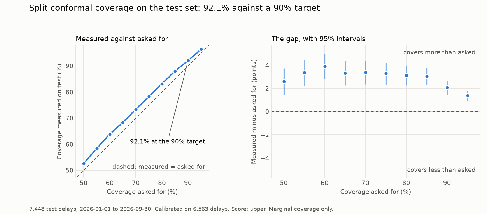
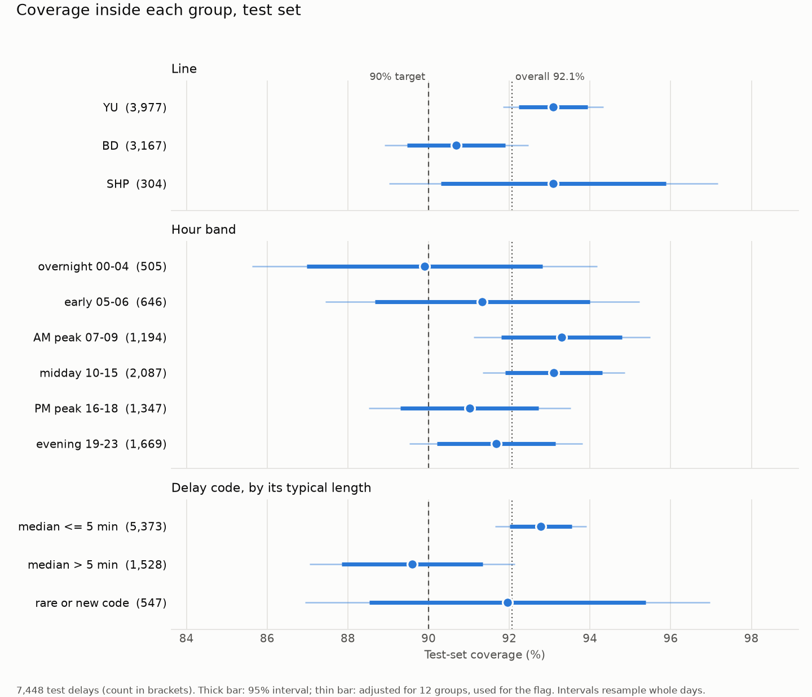

# TTC delay intervals

90% prediction intervals for how long a logged Toronto subway delay lasts, with the coverage guarantee checked on delays the model never saw.
Measured once on 7,448 delays from January to September 2026, the intervals covered **92.1%** (95% CI 91.4% to 92.7%) against a 90% target.
No line, hour band or delay-code tier is shown to undercover at this power. The guarantee is marginal, and 2025 and 2026 were not exchangeable: 2026 delays ran shorter.

**Read the write-up:** [docs/writeup.pdf](docs/writeup.pdf) (4 pages) or [docs/writeup.md](docs/writeup.md).

Japan's railways are famous for running to the minute, which fascinates me.
Instacart takes a different angle on lateness: it uses quantile regression to
estimate an upper bound on delivery time and plans around that bound rather
than the average
([InfoQ, 2017](https://www.infoq.com/news/2017/01/ripert-instacart-ml-optimization)).
After countless delays on the TTC, I wanted to ask the same question of our
own subway: not "how long is a delay on average" but "how long, nine times
out of ten". A rider does not benefit from "expect 5 minutes". They benefit
from "90% chance service resumes within X minutes", and from knowing that
the 90% is real.

## Example

```
python src/18_serve.py --line YU --station "UNION STATION" --code SUDP --time "2026-03-04 08:15"
```

```json
{
  "input": {"line": "YU", "station": "UNION STATION", "code": "SUDP", "time": "2026-03-04T08:15:00"},
  "model_saw": {"hour_band": "AM peak 07-09", "day_of_week": 2, "station": "UNION STATION", "code": "SUDP"},
  "interval_minutes": {"lower": 1.0, "upper": 9.69},
  "reads_as": "90% chance the delay clears within 9.7 minutes",
  "parts": {"model_q90": 9.609, "q_hat": 0.0835, "model_median_no_guarantee": 4.3},
  "guarantee": "marginal: 90% averaged over all delays, not within any one group. Measured once at 92.1% on 7,448 test delays (2026-01-01 to 2026-09-30).",
  "test_coverage_in_this_delays_groups": {
    "line": {"group": "YU", "n_test_delays": 3977, "coverage": 0.931, "ci95": [0.922, 0.939]},
    "hour_band": {"group": "AM peak 07-09", "n_test_delays": 1194, "coverage": 0.933, "ci95": [0.918, 0.948]}
  },
  "caveat": "retrospective: needs the TTC delay code, which is assigned after the delay starts"
}
```

The same call for code `MUPR1` at Kennedy on a Saturday at 02:30 returns
112.2 minutes. The conformal correction is the same 0.08 minutes in both; the
width comes from the model's 90th percentile, so a routine stop and a long
shutdown get different bounds. `python src/18_serve.py --serve` answers the
same question over HTTP at `http://127.0.0.1:8000/interval?line=...&station=...&code=...&time=...`.

This is a **retrospective** analysis, not a rider-facing tool: the delay code
is assigned by TTC staff after a delay starts.

## Results



Split conformal coverage on the test set, at ten levels. Every level
overcovers, by 3 to 4 points in the middle. The guarantee held, but the
result sits above the 89.0% to 91.0% that exchangeable data would give: the
2026 delays drifted shorter, so the intervals were wider than they needed to be.



Coverage inside 12 groups fixed in advance. A group undercovers only if its
Bonferroni-adjusted interval (thin bar) lies wholly below 90%; none does. The
caveat is power: the audit rules out large undercoverage, not a shortfall of
a point or two. The two lowest groups, the "median > 5 min" code tier (89.6%)
and overnight (89.9%), were also the lowest on calibration.

## Rebuild it

Two commands after creating an environment: install, then rebuild.

macOS / Linux:

```bash
python -m venv .venv
source .venv/bin/activate
pip install -r requirements.txt
python rebuild.py
```

Windows (PowerShell):

```powershell
python -m venv .venv
Set-ExecutionPolicy -Scope Process -ExecutionPolicy Bypass
.\.venv\Scripts\Activate.ps1
pip install -r requirements.txt
python rebuild.py
```

`rebuild.py` downloads the raw files from Toronto Open Data, builds the
Parquet (97,136 rows), runs the acceptance test (31 checks), refits the final
model on 19,804 training rows, and prints the example above. It measures
nothing again: the test result and the group audit were measured once and are
committed in `docs/`.

## Scripts, in execution order

| Script | What it does |
|---|---|
| `01_download.py` | Fetch the raw files from the City of Toronto CKAN API |
| `02_build.py` | Normalise, validate and stack them into `data/processed/delays.parquet`; reports every row it drops |
| `03_explore.py` | The Day 1 questions, with figures |
| `04_splits.py` | Propose the chronological split dates |
| `05_groups.py` | Calibration rows per line, hour band and station |
| `06_peek.py` | Line values, station spellings, the delay-code key |
| `07_verify.py` | Acceptance test: 31 checks; exits 1 on any failure |
| `08_baselines.py` | Four baselines on the validation slice; picks one by a rule fixed in advance |
| `09_fit_final.py` | Refit the chosen model on all training rows |
| `10_leakage.py` | Temporal against random split, inside training only |
| `11_calibrate.py` | `q_hat` from the calibration slice; never reads a test delay |
| `12_test_once.py` | Measures test coverage once, then refuses to run again |
| `13_plot.py` | The Day 3 coverage figure, from saved results |
| `14_define_groups.py` | Fixes the audit groups from training and calibration rows; refuses once the audit has run |
| `15_mondrian.py` | Global against group-wise (Mondrian) conformal, on calibration halves only |
| `16_audit.py` | Coverage inside each group, from Day 3's saved rows; runs once |
| `17_plot_groups.py` | The Day 4 group figure, from the saved audit |
| `18_serve.py` | The interval as JSON, from the command line or a local server |
| `rebuild.py` | Download, build, verify, refit, one example |

Shared code, not run directly: `config.py` (every setting, including the
split dates), `data.py` (the modelling population and features),
`conformal.py`, `groups.py`, `coverage_stats.py`, `mondrian.py`.

## How it was kept honest

1. The calibration set is never trained on.
2. The test set is measured once. Models were chosen on a validation slice;
   the conformity score, the audit groups and the flag rule were committed
   before the results they govern.
3. Every filter reports how many rows it removed.
4. Marginal coverage is not described as conditional coverage.

`docs/log.md` records each decision with its reason and each prediction
before its result, and the day journals in `docs/` explain the reasoning.
How Claude (Anthropic) was used is recorded in the AI assistance section of
`docs/log.md`.

## Data

[TTC Subway Delay Data](https://open.toronto.ca/dataset/ttc-subway-delay-data/),
City of Toronto Open Data Portal, under the Open Government Licence – Toronto.

The target is `min_delay`, minutes of delay to service, **given that an
incident has been logged**. The modelling population is the 33,815 delays of
at least one minute on Lines 1, 2 and 4 (YU, BD, SHP), January 2023 to
September 2026. Splits are by date: train before 2025-04-01, calibration
2025-04-01 to 2025-12-31, test from 2026-01-01.

## Limitations

- The 90% is an average over all delays. The audit checked 12 fixed groups,
  not single codes, stations or their combinations.
- Calibration and test were not exchangeable. The drift was harmless this
  time; drift the other way would break coverage silently. Adaptive conformal
  inference (Gibbs and Candès, 2021) is the next step.
- The rarest, longest delay codes are too rare to audit on this data.
