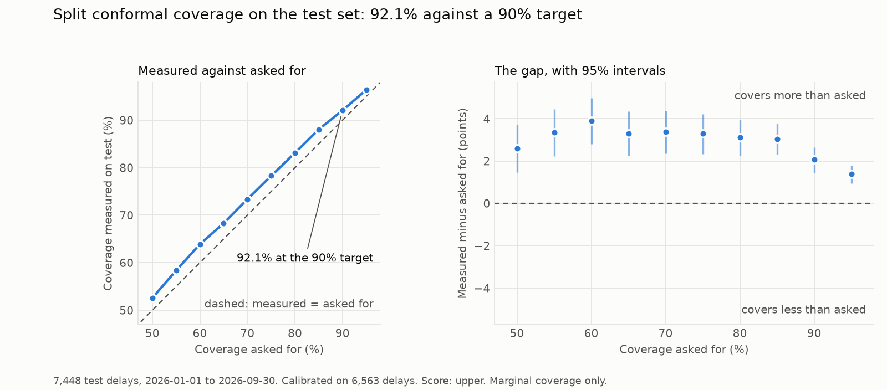
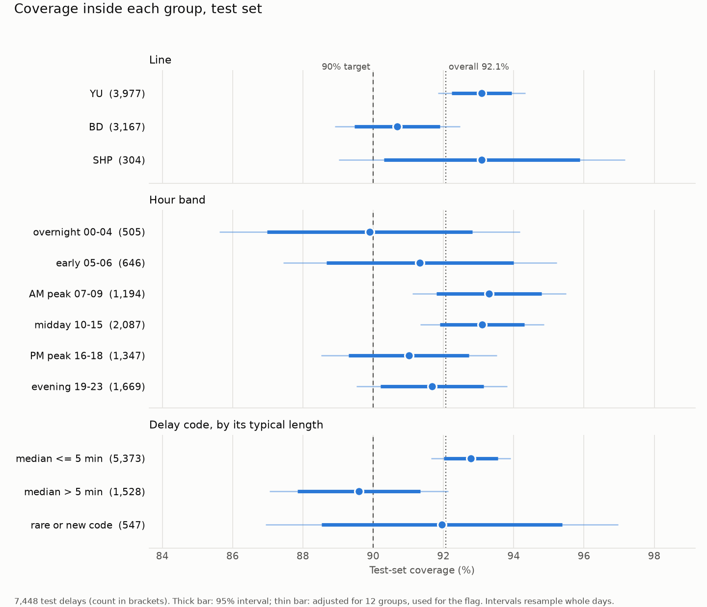

# How long until a TTC subway delay clears? Prediction intervals with a checked coverage guarantee

Nuaiman Hasan · November 2026 · [github.com/nothing015/ttc-delay-intervals](https://github.com/nothing015/ttc-delay-intervals)

I built 90% prediction intervals for the length of a logged TTC subway delay, using split conformal prediction on top of a quantile gradient-boosting model. On 7,448 delays from January to September 2026, measured once, the intervals covered **92.1%** of delays (95% CI 91.4% to 92.7%) against a 90% target. **Marginal coverage holds; no fixed group is shown to undercover at this power.** None of the 12 groups I fixed in advance (3 lines, 6 hour bands, 3 delay-code tiers) undercovers under a Bonferroni-corrected rule. The result also sits above the range that exchangeable data would produce (89.0% to 91.0%). Calibration (2025) and test (2026) were not exchangeable: delays in 2026 ran shorter, so the intervals were wider than they needed to be.

## 1. The question

A rider told "expect 5 minutes" cannot decide whether to wait or walk. In my data the median delay is 5 minutes but the 90th percentile is 14, so a rider given the typical figure faces 14 minutes or more one time in ten. The useful statement is an upper bound with a stated reliability, "90% chance service resumes within X minutes", plus evidence that the 90% is real on data the model never saw.

The target is `min_delay`, the minutes of delay a logged incident caused, **given that an incident has been logged**. I do not predict whether a delay happens. The model also uses the TTC's delay reason code, which staff assign after the fact. That makes this a retrospective analysis, not a tool a rider could use on a platform.

## 2. Data

The source is the TTC Subway Delay Data on the City of Toronto Open Data Portal (Open Government Licence – Toronto). I used January 2023 to September 2026: 97,136 logged incidents. Earlier years span the pandemic and other operating regimes; mixing them would weaken the exchangeability the guarantee rests on.

Only 34,163 incidents (35.2%) caused a delay of at least one minute. I kept those on Lines 1, 2 and 4 (YU, BD, SHP), dropping 348 rows: 339 from Line 3, which closed in July 2023 and sits entirely in the training period, 7 bus and streetcar labels, and 2 with no line. That leaves **33,815 delays**. Delays are heavily skewed: median 5 minutes, 90th percentile 14, 99th percentile 46, maximum 716.

The split is by date, never at random:

| Slice | Dates | Delays | Used for |
|---|---|---|---|
| Fit | 2023-01 to 2024-12 | 17,281 | training the baselines |
| Validation | 2025-01 to 2025-03 | 2,523 | choosing one model |
| Calibration | 2025-04 to 2025-12 | 6,563 | the conformal correction only |
| Test | 2026-01 to 2026-09 | 7,448 | measured once |

One data problem is worth naming: a portal file named `.xlsx` was really CSV text, and the first build silently lost all 47,915 rows from 2025 on while printing a plausible total. The build now checks file contents, not names, and every filter reports the rows it removes.

## 3. Method

**The model.** I scored four baselines on the validation slice by pinball loss at the 90th percentile, a rule fixed in code before any score was printed. Gradient boosting with quantile loss, fitted on `log1p(min_delay)`, won: 1.774 minutes against 2.251 for one global quantile, 21.2% lower. Linear quantile regression was within 1.3% (1.797), which on 2,523 rows is a tie. A percentile per station and hour band was *worse* than the global number (2.316): a tail quantile from as few as 30 rows is noise. The features are line, hour band, day of week, delay code and station, with rare codes and stations pooled. The winner was refitted on all 19,804 training rows.

**The conformal step.** A quantile model has no coverage guarantee on new data: boosting covered 88.5% of validation delays. Split conformal prediction corrects that using held-out rows. For each calibration delay I compute a conformity score, *actual delay minus predicted 90th percentile*. With n = 6,563 scores, I take the k-th smallest, k = ⌈(n + 1) × 0.9⌉ = 5,908, and call it q̂. The interval for a new delay runs from 1 minute up to its predicted 90th percentile plus q̂.

The guarantee comes from ranks, not from the model. If calibration and test delays are exchangeable, a new delay's score is equally likely to land in any of the n + 1 positions among the calibration scores, so it falls in the bottom k with probability k / (n + 1) ≥ 0.9. A worse model gives larger scores, a larger q̂ and wider intervals, but the same coverage.

This one-sided score, a form of conformalized quantile regression, was fixed before any code ran. I chose it over absolute residuals because symmetric intervals suit skewed delays badly: they give a 5-minute delay and an hour-long shutdown the same width.

## 4. Marginal coverage

The model's own 90th percentile covered 89.8% of calibration delays, so the correction was tiny: **q̂ = 0.0835 minutes**. A rehearsal on calibration rows gave 90.2% on random halves (88.9% to 90.8% over 20 seeds) but 91.8% when the later half was checked against the earlier, a first hint of drift.

On the test set, measured once, coverage was **92.1%** (95% CI 91.4% to 92.7%). The guarantee held. The median upper bound was 11.5 minutes, and 65% of delays got a tighter bound than the 14 minutes one would give everyone without a model.

*Figure 1. Coverage measured on the test set against coverage asked for, at ten levels. Every level overcovers, by 3 to 4 points between 55% and 85%.*

But 92.1% is not "extra safety". With continuous scores, exchangeable data gives coverage close to k / (n + 1) = 90.0%; allowing for sampling noise in both sets, the expected range is 89.0% to 91.0%. The result and its whole confidence interval lie above that range. It is drift, not a bug: the random-half rehearsal recovered 90%, and a 14-minute bound with no model at all covered at least 90.0% of 2025 delays but 92.9% of 2026 delays. The delays themselves got shorter, across the whole distribution (Figure 1). Drift in this direction is harmless for validity; the intervals were simply wider than 2026 needed.

## 5. Coverage inside groups

The guarantee is **marginal**: an average over all delays. If SHP (304 test delays, 4.1%) fell to 80%, the rest would only need about 92.6% for the overall figure to still read 92.1%. So I audited coverage inside groups, under a design committed before the audit ran:

- **Groups:** the 3 lines, 6 hour bands, and delay codes grouped into tiers by their median delay over the training rows, cut at 5, 10 and 20 minutes, plus a tier for codes the model pools as rare or new. Station was excluded: only 21 of 277 stations reach 100 calibration rows.
- **Intervals:** a bootstrap that resamples whole days of the test period (2,000 times), because delays on one bad day are not independent.
- **Rule:** a group undercovers only if its Bonferroni-adjusted interval (family-wise 95%, z = 2.87 for 12 groups) lies entirely below 90%. Without the correction, 12 tests at 95% would produce a false flag about 46% of the time.

The audit read the per-row test results Day 3 saved; nothing was re-predicted.

| Grouping | Group | n | Coverage | 95% CI | Adjusted CI |
|---|---|---|---|---|---|
| Line | YU | 3,977 | 93.1% | 92.2–93.9 | 91.8–94.3 |
| | BD | 3,167 | 90.7% | 89.5–91.9 | 88.9–92.5 |
| | SHP | 304 | 93.1% | 90.3–95.9 | 89.0–97.2 |
| Hour band | overnight 00–04 | 505 | 89.9% | 87.0–92.8 | 85.6–94.2 |
| | early 05–06 | 646 | 91.3% | 88.7–94.0 | 87.4–95.2 |
| | AM peak 07–09 | 1,194 | 93.3% | 91.8–94.8 | 91.1–95.5 |
| | midday 10–15 | 2,087 | 93.1% | 91.9–94.3 | 91.3–94.9 |
| | PM peak 16–18 | 1,347 | 91.0% | 89.3–92.7 | 88.5–93.5 |
| | evening 19–23 | 1,669 | 91.7% | 90.2–93.1 | 89.5–93.8 |
| Code tier | median ≤ 5 min | 5,373 | 92.8% | 92.0–93.5 | 91.7–93.9 |
| | median > 5 min | 1,528 | 89.6% | 87.9–91.3 | 87.0–92.1 |
| | rare or new code | 547 | 92.0% | 88.5–95.4 | 86.9–97.0 |

*Table 1. Test coverage by group. Intervals resample whole days.*

*Figure 2. The same table drawn: thick bar 95% interval, thin bar the adjusted interval the flag uses. Every thin bar crosses 90%.*

**No group undercovers, and none would be flagged even on its unadjusted 95% interval.** This is the negative result I committed on Day 1 to report rather than slicing until something broke. Three observations stand, none of them a finding at this power:

- The two lowest groups, the "median > 5 min" code tier (89.6%) and overnight (89.9%), were also the two lowest on calibration. The pattern repeats across 2025 and 2026.
- BD (90.7%) sits 2.4 points below YU (93.1%), though the two were level on calibration. BD gained less from the 2026 shift. I can describe this, not explain it.
- Rare or new codes grew from 5.5% of calibration delays to 7.3% of test, and their misses cluster by day (design effect 2.3).

**Power is the honest limit.** The adjusted intervals run about ±1 to ±3 points in the large groups and ±4 to ±5 in the small ones. The audit rules out large undercoverage, not a shortfall of a point or two.

**One prediction became untestable.** On Day 1 I predicted the longest codes would undercover (`MUPR1` has a median of 72.5 minutes). But no known code has a training median between 10 and 20 minutes, so that tier was empty, and the tier above 20 minutes had only 43 calibration rows. The pre-set rule merged it into its neighbour, where the longest codes are under 3% of the rows. I kept the rule and recorded, before the audit ran, that this question is out of reach on this data.

## 6. Would group-wise (Mondrian) conformal help?

Mondrian conformal runs the same procedure inside each group, giving each its own q̂ and its own 90% guarantee. I tested it on calibration halves only. Choosing it after seeing which test groups were low, then scoring it on test, would tune the method to the test set.

On random halves, which are exchangeable by construction, it did what theory says. It lifted the three groups the global q̂ left low to about 90%, at a cost in median upper bound:

| Group | Global q̂ | Mondrian | Median bound |
|---|---|---|---|
| median > 5 min | 87.6% | 89.9% | 20.2 → 23.9 min |
| overnight 00–04 | 88.4% | 90.3% | 13.5 → 15.4 min |
| early 05–06 | 87.8% | 90.1% | 10.9 → 12.8 min |

On temporal halves, with the 2025 drift, it made things **worse**. The spread of coverage across groups widened in every grouping (lines 4.5 → 11.2 points, hour bands 2.5 → 5.3, code tiers 1.6 → 6.4). SHP fell to 81.4%, because its own q̂ came from about 145 earlier rows and the later rows had moved. A per-group correction learned from old data is still old. Mondrian fixes imbalance between groups; it does not fix drift over time, and in small groups it adds noise.

## 7. Limitations

- **Marginal only.** The guarantee is an average. The audit covers 12 groups fixed in advance; it says nothing about single codes, stations, or combinations such as "this code at night".
- **Exchangeability failed.** It failed in the harmless direction this time. Drift the other way would break coverage without warning.
- **Retrospective.** The model needs the delay code. A deployable version would drop it; it would keep the guarantee, but its intervals would likely be wider.
- **The long tail is untested.** The codes most likely to fail are too rare to audit on nine months of calibration data.

## 8. Next steps

The main gap is drift. **Adaptive conformal inference** (Gibbs and Candès, 2021) updates the correction as new delays arrive, raising it after misses and lowering it after hits, and targets long-run coverage under distribution shift. A clean test of it, or of Mondrian, needs months published after September 2026.

With a hundred times the data, the conformal step would stay trivial: it sorts one score per row. The audit would change: most stations and single codes would clear 100 calibration rows, so Mondrian could run at the level riders care about. The bottleneck would move to the free-text station field, which already holds 610 spellings for about 70 stations.

## References

- Angelopoulos, A. N. and Bates, S. (2021). *A Gentle Introduction to Conformal Prediction and Distribution-Free Uncertainty Quantification.* arXiv:2107.07511.
- Romano, Y., Patterson, E. and Candès, E. (2019). *Conformalized Quantile Regression.* NeurIPS.
- Gibbs, I. and Candès, E. (2021). *Adaptive Conformal Inference Under Distribution Shift.* NeurIPS.
- Vovk, V., Gammerman, A. and Shafer, G. (2005). *Algorithmic Learning in a Random World.* Springer. (Mondrian conformal prediction.)
- City of Toronto. *TTC Subway Delay Data.* Open Data Portal, Open Government Licence – Toronto.
